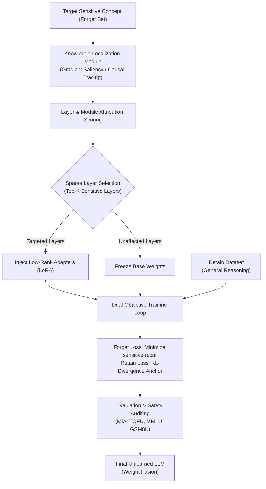

# SURF-LLM
**Sparse Unlearning with Reasoning-Preserving Framework for Large Language Models**

[](https://www.python.org/downloads/)
[](https://pytorch.org/)
[](https://opensource.org/licenses/MIT)

> **Selective Unlearning in Large Language Models (LLM Privacy & Safety)**  
> *A Layer-wise Sparse LoRA Framework*  
> **Candidate:** Krishnanand Tiwari (USN: SCA25MCA109)  
> **Program:** Master of Computer Applications (MCA), 2026–2027

---

## 📌 Overview

Large Language Models (LLMs) inadvertently memorize sensitive personal identifiable information (PII), copyrighted materials, and hazardous data. Retraining models from scratch to honor privacy mandates (e.g., GDPR's "Right to be Forgotten") is computationally prohibitive. Conversely, standard unlearning methods (such as global gradient ascent) cause **catastrophic forgetting**, severely degrading core reasoning and logic.

**SURF-LLM** solves this with surgical precision:
1. **Knowledge Localization:** Uses gradient saliency and causal attribution to identify the exact transformer layers encoding sensitive concepts.
2. **Sparse LoRA Injection:** Attaches trainable Low-Rank Adapters (LoRA) *strictly* to the identified high-sensitivity layers while keeping unaffected layers completely frozen.
3. **Dual-Objective Optimization:** Optimizes a composite objective that suppresses sensitive concept recall while anchoring general token distributions via KL divergence on benign retain data.
4. **Adapter Fusion:** Seamlessly fuses adapter deltas ($\Delta W = B \cdot A$) back into the base weights for zero-overhead deployment.

---

## 🏛️ System Architecture



---

## 📂 Repository Structure

```
SURF-LLM/
├── configs/
│   └── default.yaml              # Default experiment hyperparameters
├── src/
│   └── surf/
│       ├── localization/         # Layer attribution & sensitivity profiling
│       │   ├── saliency.py
│       │   └── causal_trace.py
│       ├── adapters/             # Sparse LoRA configuration & injection
│       │   └── sparse_lora.py
│       ├── trainer/              # Dual-objective unlearning loop
│       │   ├── objectives.py
│       │   └── trainer.py
│       ├── evaluation/           # Auditing (TOFU, MIA, MMLU, GSM8K)
│       │   ├── forget_metrics.py
│       │   └── reasoning_metrics.py
│       └── fusion/               # Base weight fusion
│           └── fusion.py
├── scripts/
│   ├── run_localization.py       # Profile layer sensitivity
│   ├── run_unlearn.py            # End-to-end unlearning pipeline
│   ├── run_eval.py               # Benchmark evaluation
│   └── fuse_weights.py           # Fuse LoRA into base model
├── notebooks/
│   └── surf_llm_colab_demo.ipynb # Free Colab T4/A100 notebook
├── requirements.txt
├── setup.py
└── README.md
```

---

## 🚀 Quickstart

### 1. Installation

```bash
cd /home/krishna/SURF-LLM
python3 -m venv venv
source venv/bin/activate
pip install -r requirements.txt
pip install -e .
```

### 2. Run Layer Localization
Find which layers encode the sensitive knowledge:
```bash
python scripts/run_localization.py --config configs/default.yaml
```

### 3. Run Sparse Unlearning
Train sparse LoRA adapters exclusively on the sensitive layers:
```bash
python scripts/run_unlearn.py --config configs/default.yaml
```

### 4. Evaluate Unlearning vs Reasoning Retention
```bash
python scripts/run_eval.py --config configs/default.yaml
```

---

## 📊 Objective Formulation

$$\mathcal{L}_{\text{total}} = \mathcal{L}_{\text{forget}}(\theta_{\text{LoRA}}) + \lambda \cdot \mathcal{D}_{\text{KL}}(P_{\text{base}} \,\|\, P_{\text{unlearned}})$$

- **$\mathcal{L}_{\text{forget}}$**: Penalizes sensitive token predictions or aligns sensitive prompts to neutral refusal tokens.
- **$\mathcal{D}_{\text{KL}}$**: Enforces probability distribution parity against original base weights on benign reasoning corpora.

---

## 📜 License
MIT License - Copyright (c) 2026 Krishnanand Tiwari
